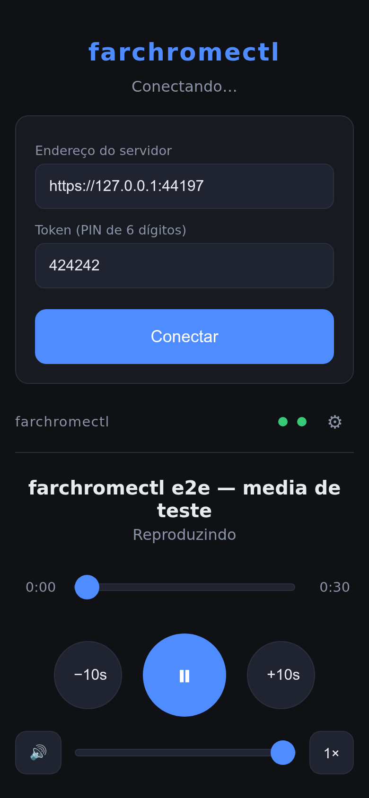
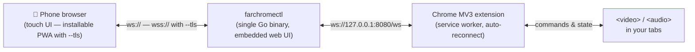
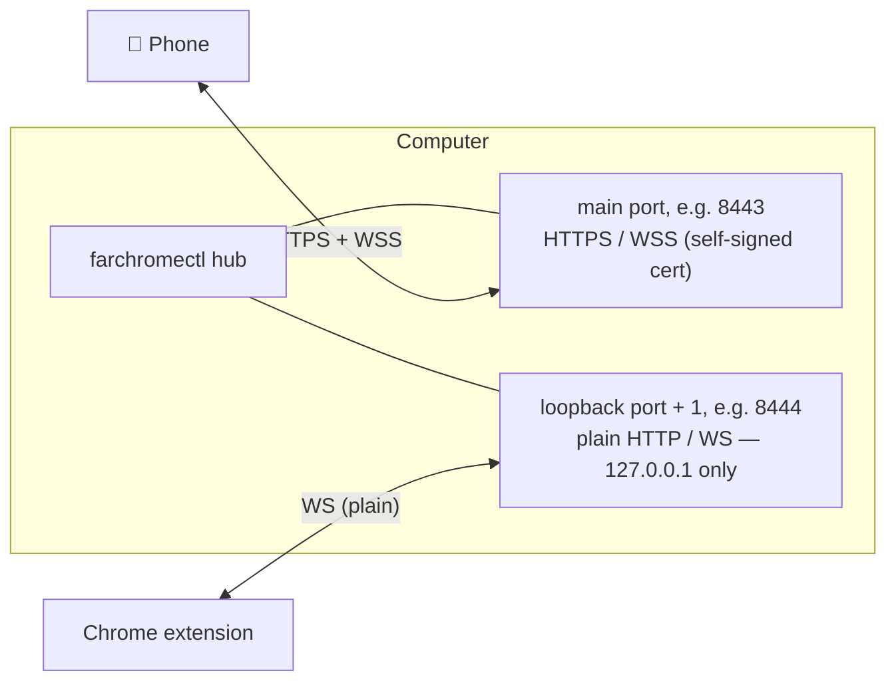

# farchromectl

**English** | [Português (BR)](README.pt-BR.md)

[](https://go.dev)
[](https://developer.chrome.com/docs/extensions/develop)
[](LICENSE)

Control the media playing in your Chrome — **from your phone**, over your
home Wi-Fi/LAN. One compiled Go binary with the web UI embedded, plus a tiny
Chrome extension. No runtime dependencies, no cloud: nothing leaves your
local network.



The screenshot above is the real web UI, captured by the project's own E2E
harness: a dedicated Chrome with the production extension installed, media
playing, server and extension indicators connected.

---

## Features

- Play/pause, seek ±10s and scrubbing
- Volume, mute and playback speed (1×, 1.25×, 1.5×, 2×)
- Multi-tab target selector — choose which tab the controls drive
- Now-playing metadata (title, position, duration)
- Token authentication: 6-digit PIN with per-IP lockout
- Discovery from the phone: last working URL → mDNS name
  (`farchromectl.local`) → manual entry
- LAN URLs and a QR code printed in the terminal at startup
- Optional TLS (`--tls`): self-signed certificate, installable PWA on the
  phone
- Extension auto-reconnects (MV3 service worker) — survives Chrome's idle
  suspension
- Credentials remembered on the phone; no re-login on reconnects

## How it works



With `--tls`, the topology stays the same, but the two links use different
listeners:



The phone gets HTTPS (secure context → service worker → installable PWA).
The extension keeps plain WebSocket on a loopback-only listener at
**main port + 1**: that traffic never leaves the machine, so converting it
to `wss://` would only add a certificate-import step to Chrome — no
security gain.

## Requirements

- Go 1.23+ (build time only — the resulting binary is static and standalone);
- Google Chrome, Chromium or Edge (Manifest V3);
- Phone and computer on the **same network** (home Wi-Fi, for example).

## Quick start

1. Build:

   ```sh
   make build                 # → bin/farchromectl
   # or directly:
   go build -o bin/farchromectl ./cmd/farchromectl
   ```

   If Go is installed in your user space, put it on `PATH` first (adjust to
   your install):

   ```sh
   export PATH="$HOME/.local/go-toolchain/bin:$PATH"
   ```

   Optional install: `make install` (copies to `~/.local/bin/farchromectl`).

2. Run the server:

   ```sh
   ./bin/farchromectl             # default: http://<LAN-IP>:8080
   ./bin/farchromectl --tls       # optional: HTTPS + installable PWA
   ```

   On first run it generates a **6-digit token**, saves it to
   `~/.config/farchromectl/config.json` (mode `0600`) and prints it in the
   banner, together with the LAN URLs and a **QR code** pointing at the main
   URL (the QR is only printed when stdout is a terminal).

3. Install the extension in desktop Chrome:

   - open `chrome://extensions`, enable **Developer mode**, click
     **Load unpacked** and select the `extension/` folder of this project;
   - open the extension's **Options** page and fill in the **port** and
     **token** printed by the server — port `8080` in plain mode; with
     `--tls`, the **loopback port** (main port + 1, e.g. `8081` — the exact
     port is printed in the banner).

4. From the phone (same Wi-Fi): **scan the QR code** with the camera or open
   one of the printed URLs, then enter the token once — it is remembered by
   the browser.

## Configuration

CLI flags:

| Flag       | Default            | Description                                                                                          |
|------------|--------------------|------------------------------------------------------------------------------------------------------|
| `--addr`   | `0.0.0.0:8080`     | listen address, e.g. `--addr 0.0.0.0:9090`                                                           |
| `--token`  | generated/persisted | force a specific 6-digit token (does not change the saved file)                                      |
| `--tls`    | off                | serve HTTPS with a local self-signed certificate (installable PWA); extension keeps loopback WS on port + 1 |
| `--open`   | off                | open the UI in the local browser after startup (needs a graphical session)                            |
| `--version`| —                  | print the binary version and exit                                                                    |

Config file: `~/.config/farchromectl/config.json` (`0600`) — created on first
run with the generated token. Delete it to get a new token, or override per
run with `--token 123456` (remember to update the phone — "Forget
credentials" in the UI settings — and the extension).

TLS material: `cert.pem` + `key.pem` in the same directory, generated on the
first `--tls` run and reused afterwards.

Extension options: server port + token; under `--tls`, use the loopback port
(main port + 1).

## Security notes

- **LAN-only by design**: no tunneling, no cloud relay, no remote access.
- **Authentication**: 6-digit token on the WebSocket handshake, compared in
  constant time. Five consecutive wrong tokens from one IP lock that IP out
  for 60 s (strict: during the window the token is not even read, and
  refused attempts do not extend it). Failure streaks decay after 10
  minutes; a successful handshake clears them.
- A 6-digit PIN assumes a **trusted home LAN** — not suitable for shared or
  hostile networks.
- The token is **never published in mDNS TXT records** (they carry only the
  version).
- Firewall: expose the port only to your LAN subnet, e.g.
  `sudo ufw allow from 192.168.0.0/16 to any port 8080 proto tcp`.
- **TLS** (`--tls`): ECDSA P-256 self-signed certificate, 825-day validity
  (the longest lifetime iOS accepts for manually trusted certificates),
  SANs covering `localhost`, `farchromectl.local`, `127.0.0.1` and the local
  IPs. Reused across restarts; regenerated if your IP changes (reserve the
  IP in your router to avoid re-trusting). Trust steps on the phone:
  - **Android**: Settings → Security → Encryption & credentials → Install a
    certificate → CA certificate → select the transferred `cert.pem`.
  - **iOS**: send `cert.pem` to the phone, tap it → profile installed in
    Settings → Profile Downloaded → then Settings → General → About →
    Certificate Trust Settings → enable full trust for the certificate.

## Discovery from the phone

The UI tries, in order: (1) the last URL that worked; (2)
`http(s)://farchromectl.local:<port>` (mDNS — needs `avahi-daemon` on the
machine); (3) the manual connection form. With a **DHCP reservation** for
the computer in your router, the first try always hits and the phone
connects by itself.

## Limitations

- **No next/previous track**: the web platform does not allow triggering a
  site's Media Session handlers externally — the buttons are not faked.
- **DRM**: on protected streams, seek/volume may be accepted without real
  effect; the UI surfaces the error instead of failing silently.
- **Full PWA install requires `--tls`**: service workers need a secure
  context; over plain LAN HTTP "Add to home screen" works but without
  offline cache.
- Commands go to the "best" detected media (playing > larger > longest);
  with several tabs playing, pick the target in the UI's tab selector.

## Development

```sh
make build       # build (version stamped from git describe)
make test        # go test ./...
make vet         # go vet ./...
make e2e         # end-to-end with a real Chrome (plain HTTP mode)
make e2e-tls     # end-to-end in --tls mode
```

`make e2e` drives a **real Chrome** with the **production extension**: a
dedicated instance (temporary profile, dedicated debug port — your daily
Chrome is never touched), extension installed via CDP
`Extensions.loadUnpacked`, locally generated media, and the full chain
asserted: extension connects, `state` reports the playing media, and
`pause`/`play`/`seekTo`/`setVolume` are reflected in the media element.
`make e2e-tls` additionally verifies the HTTPS/WSS handshake against the
generated certificate, the service worker becoming ready
(`navigator.serviceWorker.ready`) and the extension connecting through the
loopback listener.

Project layout:

```
cmd/farchromectl/   entrypoint: flags, banner+QR, TLS/loopback listeners, shutdown
internal/config/    token: generation (crypto/rand) and persistence
internal/certs/     --tls: self-signed ECDSA cert (generate/persist/reuse)
internal/hub/       WebSocket relay ui<->extension, extension status
internal/server/    HTTP: /, /api/healthz, /ws (token auth + per-IP lockout)
internal/mdns/      _farchromectl._tcp announcement (fail-soft; no token in TXT)
web/                web UI embedded via go:embed (plain HTML/CSS/JS + sw.js, no build step)
extension/          Chrome MV3 extension (no remote code)
e2e/                E2E harness with a real Chrome (plain and -tls modes)
```

Tests: `go test ./...` covers the hub (relay, broadcast, extension
reconnect), config (token persistence), certs (generation/SANs/0600/reuse
across runs), server (healthz/CORS, token rejection, lockout, full
end-to-end flow over a real WebSocket dial), cmd (banner/QR/TTY gating,
TLS+loopback listener pair) and mDNS (benign failure).

## Versioning

- This project follows [SemVer](https://semver.org/): `MAJOR.MINOR.PATCH`.
- Each release is marked with an **annotated tag**: `git tag -a vX.Y.Z`.
- The version is **stamped into the binary** at build time from
  `git describe --tags --always --dirty` (via
  `-ldflags "-X main.version=…"`); check with `./bin/farchromectl
  --version` (also exposed via `/api/healthz` and the mDNS announcement).
- Per-release history: [CHANGELOG.md](CHANGELOG.md).

## Contributing

Bug reports and PRs are welcome. Please keep the bar the repo already holds:
`gofmt`/`go vet`/`go test ./...` green, `make e2e` passing, conventional
commits, no new runtime dependencies.

## License

MIT — see [LICENSE](LICENSE).
